<h1 align="center">BENCtix-CAT</h1>

<p align="center">
  <b>Arch Linux ARM, OpenRC and a keypad-first Wayland interface for the Cat S22 Flip</b><br>
  Mainline Linux on a Qualcomm QM215 flip phone, with its own kernel, <b>BENCkernel-CAT</b>
</p>

<p align="center">
  
  
  
  
</p>

<p align="center">
  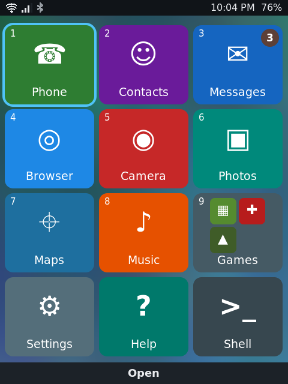
  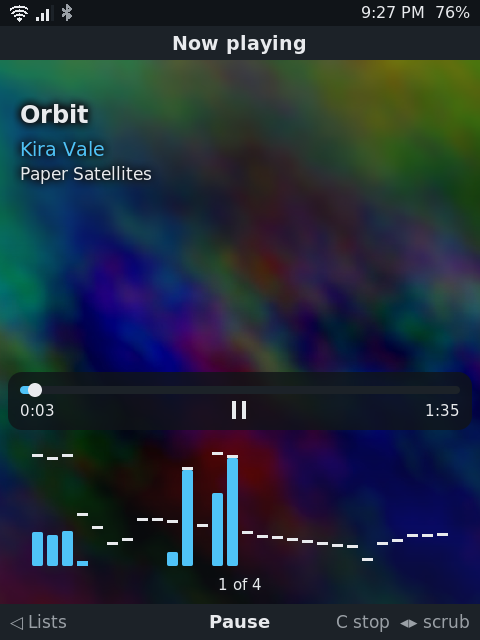
  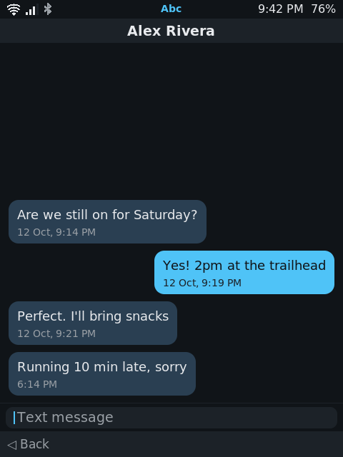
  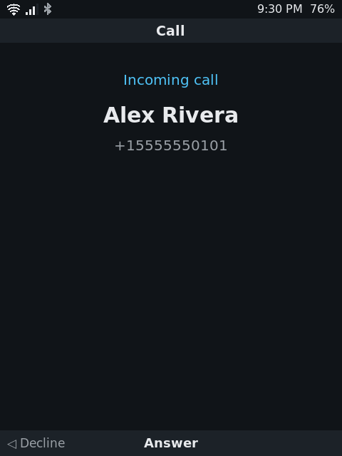
</p>

The Cat S22 Flip is a rugged Android flip phone with a 480×640 screen, a
128×128 screen on the lid and a 12-key keypad. BENCtix-CAT replaces Android
with a small, ordinary Linux system: Arch Linux ARM packages, **OpenRC instead
of systemd**, a mainline kernel, and a Wayland compositor with apps written for
a keypad and a small screen. It runs on the phone today, calls and texts
included.

Every choice behind it, from the boot chain to the music visualizer, is written
down with its reason in **[87 decisions](docs/DECISIONS.md)**. How to use the
phone is in the **[manual](MANUAL.md)**.

**[Installing it](INSTALL.md)** takes an unlocked bootloader, not root: the
firmware and a backup of your calibration are read back through lk2nd.

## What works

| | |
|---|---|
| **Calls** | VoLTE through the modem's IMS, ringtones per contact, speakerphone, in-call tones, missed-call badges. Music ducks while a call rings and stops when it is answered |
| **Texts** | SMS in and out, as conversations, with notifications and unread badges |
| **Typing** | Multi-tap T9 on the keypad everywhere, the Shell included, with every symbol under `*` and a mode indicator in the status bar |
| **Networks** | WiFi (WCN3610), Bluetooth with stereo audio to speakers and headphones, mobile data held back for carrier-only jobs, Tailscale and Mullvad, SMB file sharing |
| **Location** | GPS through the modem's own engine; Maps (Mepo) with search over OpenStreetMap |
| **Power** | Sleeps with the lid closed at about 1% an hour; the lid answers and ends calls |
| **Lid screen** | The time, battery, WiFi and Bluetooth, notifications and what is playing, over a wallpaper that can move; the side and volume keys work with the lid shut |
| **Graphics** | Adreno 308 through freedreno: the compositor, WebKit, Doom and Luanti all on the GPU |
| **Speech** | Caller names and texts read aloud by [BENCmouth](https://github.com/bropple/BENCmouth) |

## The apps

Phone · Contacts · Messages · Browser (WebKitGTK with tabs and ad blocking) ·
Camera · Photos · Maps · Music · Settings · Help · Shell (foot and tmux) ·
Games: Game Boy, NES, Match Filed, and Doom and Luanti from the SD card

<table>
  <tr>
    <td align="center">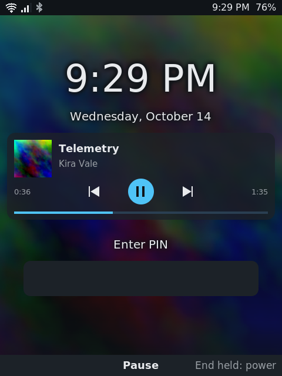<br><sub>Lock screen, music playing</sub></td>
    <td align="center">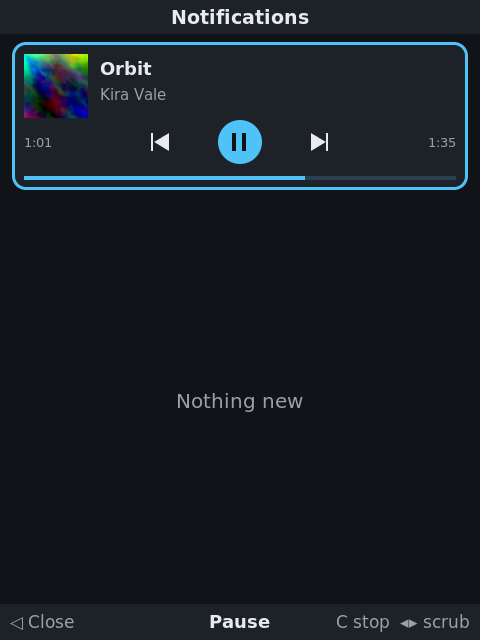<br><sub>Notifications and the player</sub></td>
    <td align="center">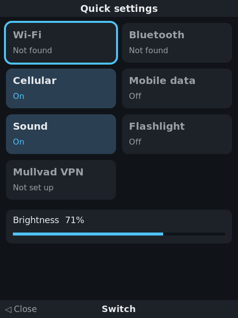<br><sub>Quick settings</sub></td>
    <td align="center">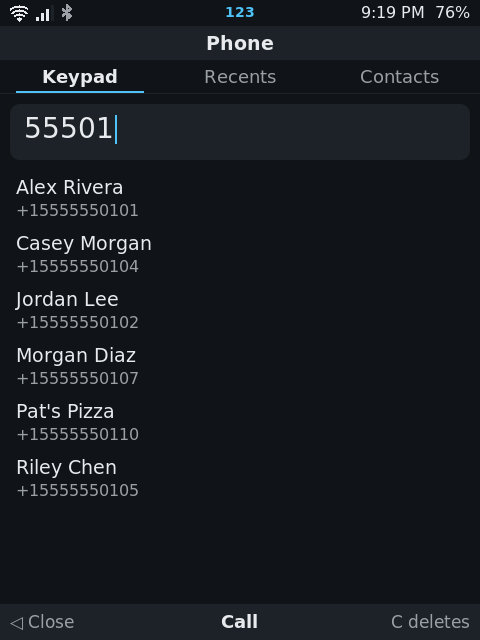<br><sub>Smart dial</sub></td>
  </tr>
  <tr>
    <td align="center">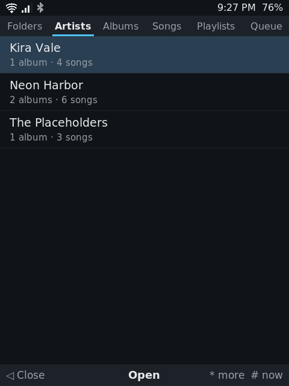<br><sub>Music by artist, from the tags</sub></td>
    <td align="center">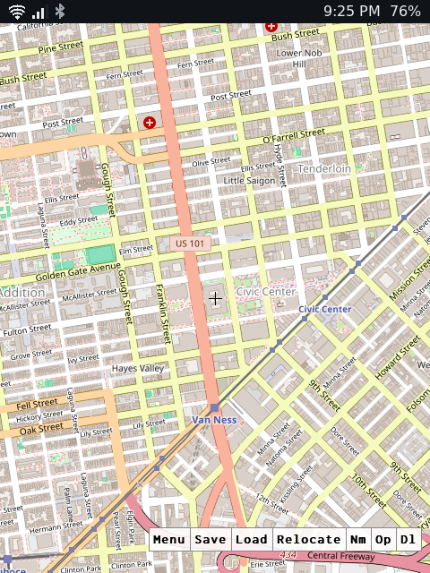<br><sub>Maps on OpenStreetMap</sub></td>
    <td align="center">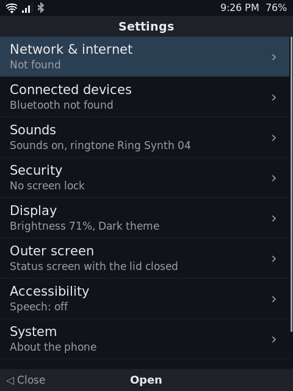<br><sub>Settings</sub></td>
    <td align="center">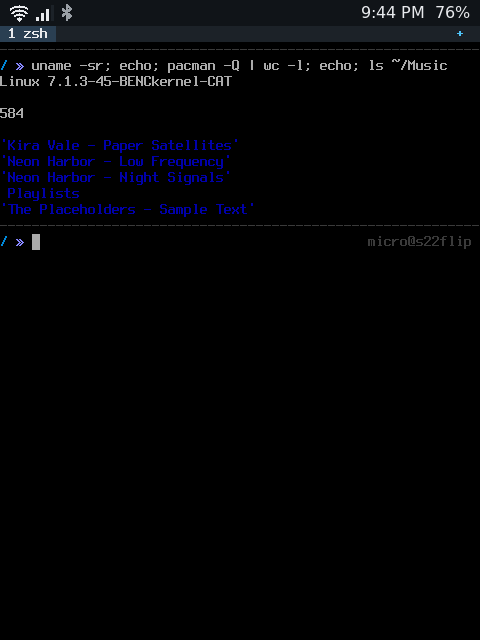<br><sub>The Shell</sub></td>
  </tr>
</table>

<sub>Screens taken from the phone's system running headless in a sandbox
(<a href="docs/DECISIONS.md">D087</a>); every name, number and song in them is invented.</sub>

## Inside

```
stock bootloaders (sbl1, tz, rpm, aboot)   never touched
        |
lk2nd (boot partition)                     reads /extlinux/extlinux.conf
        |
/boot  = eMMC cache, ext2                  kernel, DTB, current + previous
/      = eMMC userdata, btrfs (zstd)
/home  = microSD, f2fs
```

- **Kernel:** [bropple/linux](https://github.com/bropple/linux/tree/s22flip),
  the `s22flip` branch, packaged as `linux-benckernel-cat`. Updates keep the
  previous kernel in lk2nd's menu.
- **Safety:** lk2nd only reads, so kernel updates never write to the boot
  partition. Every eMMC partition Linux does not need is set read-only at boot,
  and the modem's EFS is served from files.
- **Talking to the modem:** QMI over QRTR for calls, texts, GPS and IMS, worked
  out from the phone's own binaries and traffic, never from vendor source.
- **The interface:** `s22-wm` (wlroots), the `s22ui` library and one small C
  program per app. Each app reads its own state files and sockets from small
  daemons (`s22-calld`, `s22-smsd`, `s22-celld`, `s22-gnssd`, `s22-btd`,
  `s22-t9d`, ...).
- **Hardware bring-up** and the protocol findings behind it are in
  [s22flip-linux](https://github.com/bropple/s22flip-linux).

## Building

The whole path from a stock phone is in [INSTALL.md](INSTALL.md). On an
x86_64 Arch-family host with `aarch64-linux-gnu-gcc`, `makepkg`, and
qemu-user-static registered for aarch64. Builder-specific settings (your
timezone, ...) go in an untracked `config.local.sh` over `config.sh`.

**The kernel**, with the kernel fork checked out next to this repo:

```
tools/build-benckernel-cat.sh
```

It writes `linux-benckernel-cat-<version>-<rel>-aarch64.pkg.tar.zst`, a
MANIFEST and a log. Its pacman hooks keep the previous kernel and write
`extlinux.conf` for lk2nd.

**The root filesystem**, as your normal user. The stages run in a user
namespace, so no sudo is needed:

```
stages/10-bootstrap.sh       ALARM rootfs, plus ALARM packages
stages/20-convert.sh         systemd -> OpenRC + elogind
stages/30-packages.sh        our packages and BENCkernel-CAT
stages/40-configure.sh       services, accounts, firmware (local copies)
stages/50-image.sh           boot.img (ext2) and root.simg (btrfs)
tools/flash-benctix-cat.sh   from lk2nd's fastboot: cache and userdata only
```

The phone's own packages (`packaging/`) are built on the phone with `makepkg`.

## Not in this repo

Firmware, the sensor registry and anything else taken from the phone or its
stock software are installed from local copies and never published. You need
your own phone's copies to build an image.

## Licence

Each source file names its licence (SPDX): the interface and its apps are MIT,
the system daemons GPL-2.0-only.
